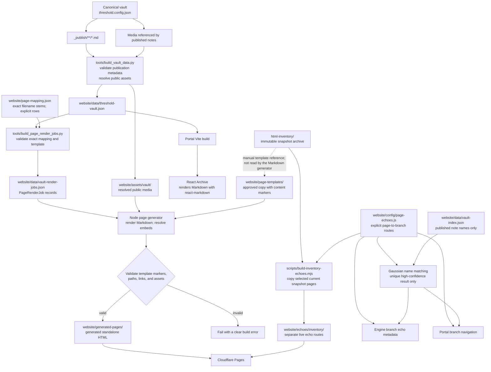

# Vault assets to generated HTML pages

This flow shows the existing Markdown-to-Portal path and the separate,
selectively mapped path that generates standalone HTML pages.



## Implemented flow

1. `npm run build:data` reads eligible Markdown under the configured vault's
   `_publish` directory, excluding notes marked `publish: false` or
   `draft: true`. It resolves only referenced media for publication.
2. `npm run build:render-jobs` reads the generated public vault JSON and
   validates the explicit entries in `website/page-mapping.json`. It emits a
   `PageRenderJob` (`noteId`, `templateId`, `outputPath`, `markdownBody`,
   `resolvedAssets`, and `status`) only for each mapped note; other published
   notes remain available to the Portal as before.
3. A mapping identifies the exact vault-relative Markdown file, an approved
   template under `website/page-templates/`, and its output path. The three
   filenames must have the exact same stem. Duplicate
   notes or output paths, missing files, and templates without one ordered
   `BEGIN_CONTENT` / `END_CONTENT` marker pair fail the render-job step.
4. `npm run build:pages` runs the Node generator after render jobs exist and
   Portal dependencies are installed. It
   renders Markdown with the Portal's `react-markdown` dependency, converts
   resolved Obsidian image embeds to their public asset URLs, injects the
   result between the template markers, and writes pages under
   `website/generated-pages/`.
5. The generator checks local links and assets and rejects unsafe output paths.
   The generated-pages directory is reserved for generator output. The original
   HTML inventory is read-only and is never rewritten.
6. The root `npm run build` runs the Markdown generator and inventory echo
   promotion before the Portal Vite build and final Cloudflare Pages assembly.
   `npm run build:ci` regenerates render jobs from committed public data and the
   mapping, then builds both page sets without accessing the private canonical
   vault. Public media referenced by mapped notes must also be present in the
   checkout. The render-jobs JSON and promoted inventory pages are build
   artifacts and are not committed.

The initial mapping is the exact-name Basin pair:

```text
_publish/basin.md
  → website/page-templates/environment/basin.html
  → website/generated-pages/environment/basin.html
```

The approved Basin template was copied from the matching reference page in
`html-inventory/website/environment/`. That copy remains the Markdown
generator's input. The inventory originals are never modified. The current
snapshot under `html-inventory/website/` is separately promoted to
`/echoes/inventory/` routes; historical, prototype, and git-history snapshots
remain unpromoted. Consequently, Basin has its existing hand-authored page, a
generated page, and a separately routed inventory echo; the template is not a
rendered page. The Waterfall inventory page is deferred because its
referenced image is generated locally and is not
committed public media. It can be promoted after that asset is explicitly
published; no Waterfall route or branch echo is emitted meanwhile.
The selected inventory Contact, House and Garden, and Mythology pages have
stale Ledger links with no target in that snapshot; only the promoted copies
route those links to the live Portal. House and Garden and Mythology also
route their missing Chamber Map link to the live World Map page.
The promoted Herb Room copy keeps the Waterfall label but renders it as
non-interactive text until the Waterfall page and its public media are ready.

## Content and layout boundary

Markdown controls the injected content only. Approved HTML templates own the
page shell, styling, navigation, and other structural markup. Raw HTML in
Markdown is not enabled; the renderer uses the same `react-markdown` behavior
as the Portal Archive.

The build reads Markdown only from `_publish`; the full vault and unrelated
media are not copied. Generated job data contains only explicitly mapped,
eligible published notes and resolved public asset URLs, never local
filesystem paths.

## Rendered pages as branch echoes

`website/config/page-echoes.js` explicitly connects each rendered HTML surface,
Portal route, and promoted inventory route to an existing Engine branch. Its
page echoes carry a low-force marker and their stylesheet dependencies, but do
not become new physics branches or participate in branch selection. The
Engine keeps them as passive branch metadata; the Portal exposes each branch's
echoes as ordinary navigation links.

Published Markdown matches use a Gaussian filename score
(`exp(-0.5 * (normalized edit distance / 0.35)^2)`). Only a unique match scoring
at least `0.82` with a `0.12` lead over the next candidate is linked. Candidate
notes come only from `_publish/` entries in the public vault index. Ties,
unpublished notes, and low-confidence matches remain unlinked; the page
generator's exact mapping contract is unchanged.

See [the Markdown pipeline](./OBSIDIAN-MARKDOWN-PIPELINE.md) for the existing
export and Portal behavior.
