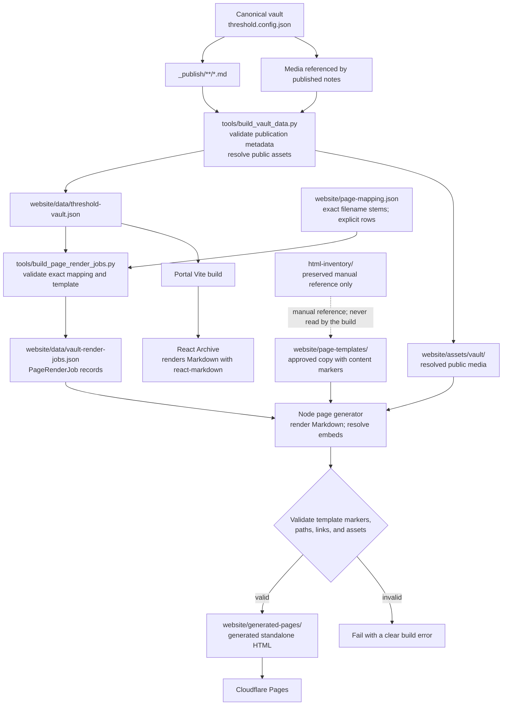

# Vault assets to generated HTML pages

This flow shows the existing Markdown-to-Portal path and the separate,
selectively mapped path that generates standalone HTML pages.



## Implemented flow

1. `npm run build:data` reads eligible Markdown under the configured vault's
   `_publish` directory, excluding notes marked `publish: false` or
   `draft: true`. It resolves only referenced media for publication.
2. `npm run build:render-jobs` reads the generated public vault JSON and
   validates the explicit entries in `website/page-mapping.json`. It emits a
   `PageRenderJob` (`noteId`, `templateId`, `outputPath`, `markdownBody`,
   `resolvedAssets`, and `status`) only for each mapped note; other published
   notes remain available to the Portal as before.
3. A mapping identifies the exact vault-relative Markdown file, an approved
   template under `website/page-templates/`, and its output path. The three
   filenames must have the exact same stem. Duplicate
   notes or output paths, missing files, and templates without one ordered
   `BEGIN_CONTENT` / `END_CONTENT` marker pair fail the render-job step.
4. `npm run build:pages` runs the Node generator after render jobs exist and
   Portal dependencies are installed. It
   renders Markdown with the Portal's `react-markdown` dependency, converts
   resolved Obsidian image embeds to their public asset URLs, injects the
   result between the template markers, and writes pages under
   `website/generated-pages/`.
5. The generator checks local links and assets and rejects unsafe output paths.
   The generated-pages directory is reserved for generator output. The original
   HTML inventory is read-only and is never rewritten.
6. The root `npm run build` runs the generator before the Portal Vite build and
   final Cloudflare Pages assembly. `npm run build:ci` regenerates the render
   jobs from the committed public vault export and mapping, then generates
   pages without accessing the private canonical vault. Public media referenced
   by mapped notes must also be present in the checkout. The render-jobs JSON
   is a build artifact and is not committed.

The initial mapping is the exact-name Basin pair:

```text
_publish/basin.md
  → website/page-templates/environment/basin.html
  → website/generated-pages/environment/basin.html
```

The approved Basin template was copied from the matching reference page in
`html-inventory/website/environment/`. That copy is the build input; the
inventory remains untouched and is not read by the build. A Waterfall HTML
reference also exists there, but the canonical `_publish` tree currently has a
Waterfall JSON record rather than an eligible `waterfall.md`, so it is not
added to the Markdown generator.

## Content and layout boundary

Markdown controls the injected content only. Approved HTML templates own the
page shell, styling, navigation, and other structural markup. Raw HTML in
Markdown is not enabled; the renderer uses the same `react-markdown` behavior
as the Portal Archive.

The build reads Markdown only from `_publish`; the full vault and unrelated
media are not copied. Generated job data contains only explicitly mapped,
eligible published notes and resolved public asset URLs, never local
filesystem paths.

See [the Markdown pipeline](./OBSIDIAN-MARKDOWN-PIPELINE.md) for the existing
export and Portal behavior.
